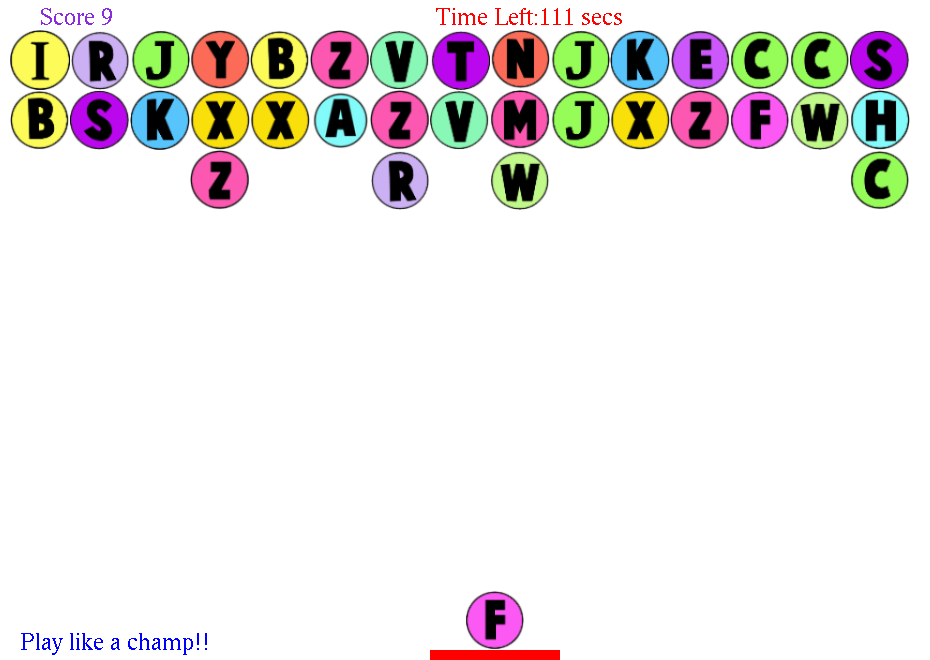
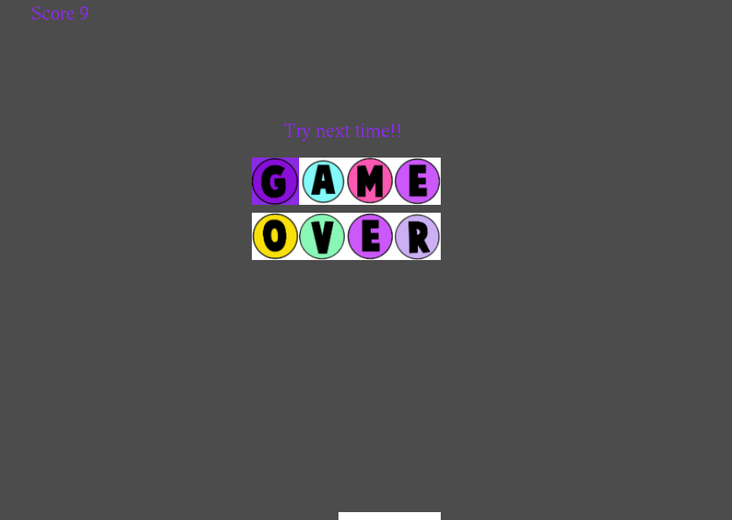

# 🔤 Word Shooter – C++ / OpenGL Word Game

A 2D word game in **C++** with **OpenGL / GLUT**, built as my semester project for **Programming Fundamentals** at FAST-NUCES Islamabad.

The top of the screen holds two rows of random letter bubbles. The game checks those rows against a **369,646-word English dictionary** and bursts any real words it finds, scoring points for them. You aim with the mouse and shoot new letters onto the board before the timer runs out.

<p align="center">
  <br>
  <em>Two rows of letter bubbles, with shot letters stacking beneath them and the next letter waiting in the shooter</em>
</p>

<p align="center">
  <br>
  <em>Game-over screen: the letters "GAME OVER" appear one by one</em>
</p>

---

## ✨ Features

- **Random letter board:** two 15-letter rows are generated for every game
- **Dictionary word detection:** the game scans the rows left to right for substrings of every length and checks each one against the dictionary. Matched words burst, their letters are replaced with new random ones, and points are added
- **Mouse aiming and shooting:** click anywhere to fire the shooter's letter towards that point
- **Wall bounces:** shots rebound off the left and right edges of the window
- **Stacking:** shot letters stick under the existing rows and pile up column by column
- **Countdown timer and live score** at the top of the screen
- **Animated game-over screen** when time runs out
- **File handling:**
  - all 26 letter textures are packed into one binary file (`image-data.bin`) and loaded at startup
  - the dictionary is read from `words_alpha.txt`
  - every word the game bursts is appended to `words.txt`

## 🎮 Controls

| Input | Action |
|---|---|
| Left-click | Shoot the current letter towards the cursor |
| `Esc` | Quit |

## 🧠 Programming Fundamentals Concepts Used

- **2D arrays:** a `char` grid holds the board (`boardalpha[9][15]`), with `-1` marking empty cells
- **Strings and nested loops:** build every substring of each row and compare it with the dictionary
- **Dynamic memory:** the dictionary is a heap-allocated `string` array of 369,646 entries
- **File I/O:** binary reads for textures, text reads for the dictionary, and appends for the burst-word log
- **Enums:** map each letter to its texture
- **Event-driven programming:** GLUT callbacks for drawing, the mouse, the keyboard and the game timer
- **Simple physics:** a direction vector computed from the click position, wall reflection, and collision with the letter stacks

## 🛠️ Build & Run

> Tested on **Ubuntu / Linux**. On Windows, use **WSL** (Ubuntu) with WSLg so the game window can open.

```bash
chmod +x install-libraries.sh
./install-libraries.sh   # installs g++, make, freeglut, GLEW, FreeImage
make
./word-shooter
```

Run the game from the project folder so it can find `image-data.bin` and `words_alpha.txt`. Loading the dictionary takes a few seconds at startup.

## 📁 Project Structure

```
.
├── wordshooter.cpp      # Game logic: board, shooting, word detection, timer, rendering
├── util.cpp / util.h    # Drawing and file helpers (course starter code)
├── CImg.h               # Image library used by the starter code
├── image-data.bin       # 26 letter-bubble textures packed into one binary file
├── words_alpha.txt      # English dictionary (369,646 words)
├── Makefile
├── install-libraries.sh
└── screenshots/
```

## 🚀 Possible Improvements

- Check for new words after every shot, not only on the initial rows
- Burst exactly the letters of the matched word and score by word length
- Speed up dictionary lookups with binary search or a hash set (the list is already sorted)
- Add a start menu, sound effects and a high-score table

## 🔧 Changes After Submission

- Fixed a crash at startup: the dictionary loader in `util.cpp` used a `while (!eof())` loop, which read one word past the end of the array. It now stops as soon as a read fails.

## 🙏 Acknowledgements

- The starter template and graphics utilities (`util.cpp`, `util.h`) were provided by the course instructor, **Dr. Sibt Ul Hussain**.
- The word list comes from [dwyl/english-words](https://github.com/dwyl/english-words).
- [CImg](https://cimg.eu/), the C++ image processing library.

## 👤 Author

**Muhammad Huzaifa**
